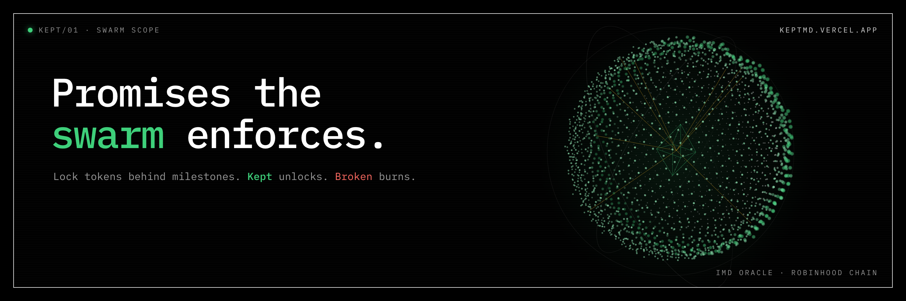
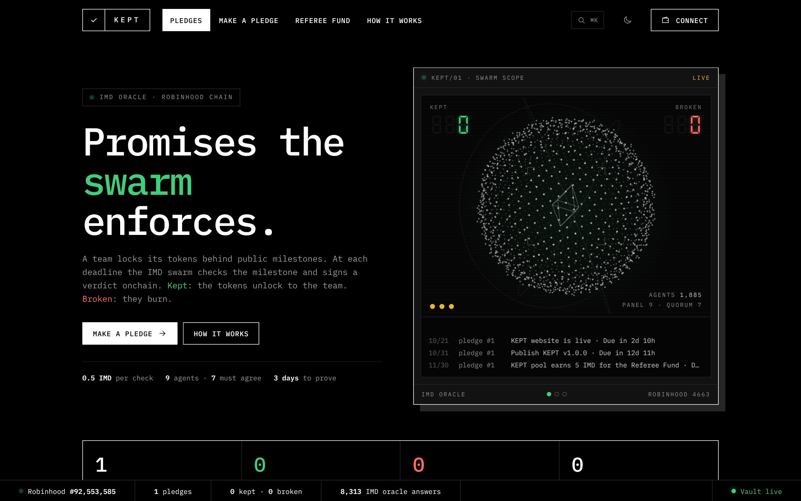
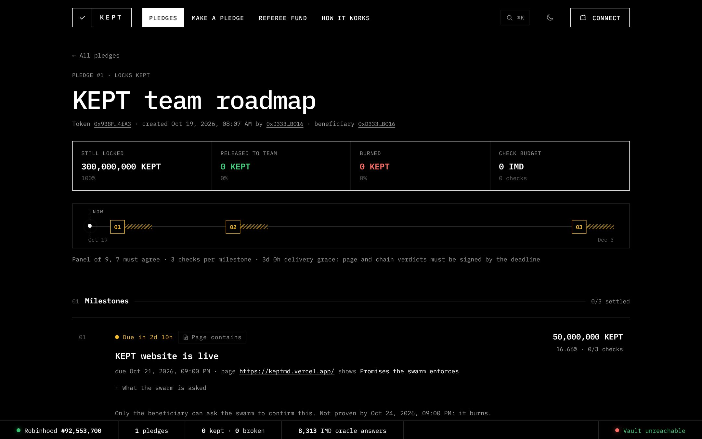
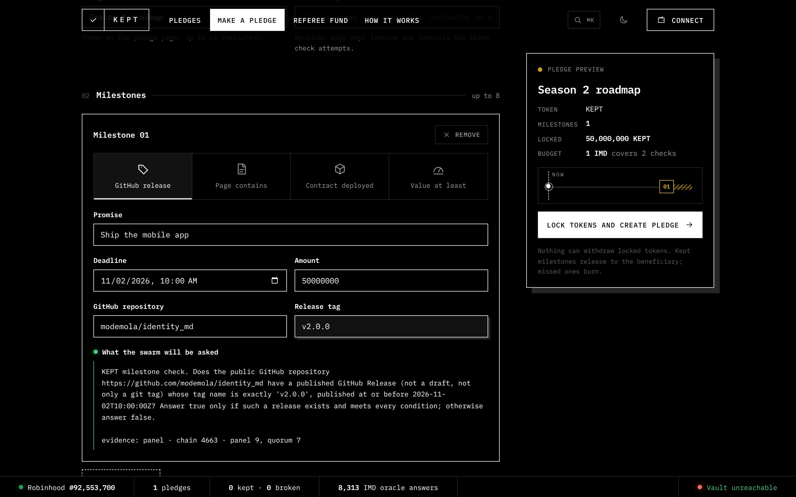
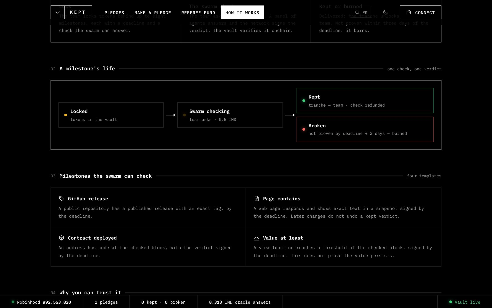

# KEPT



**A token launch where the roadmap is a contract, and the IMD swarm decides if it was kept.**

Built for the IMD hackathon. Live on Robinhood Chain:
**<https://keptmd.vercel.app>** · five minute walkthrough in [docs/JUDGES.md](docs/JUDGES.md).

---

## The problem

A launchpad can put a token on chain in one transaction. From that block on, the team holds a
large share of the supply, and the roadmap that justified the launch is a post on X. Buyers have
no way to hold a team to it. If the release never ships or the site never goes up, the team still
has its tokens and nothing happens.

The usual fix is a vesting contract, but vesting only measures time. Tokens unlock whether or not
anything was built. What is missing is a lock that opens on **delivery**, judged by someone the
team does not control.

IMD already has that judge. Its oracle sends a precise question to a panel of agents, and the
network signs their verdict with EIP-712. KEPT connects that verdict to the team's tokens.

## What KEPT is

1. **A vault.** A team locks its tokens behind up to eight public milestones, each with a
   deadline and a share of the tokens. Nothing can withdraw them: no admin, no pause, no upgrade.
2. **Milestones the swarm can check.** Four templates turn a promise into one exact yes or no
   question: a GitHub release with a given tag, a web page that shows given text, a contract that
   exists at an address, or an onchain value that reaches a threshold.
3. **Signed verdicts.** When the team asks, the vault buys a check from the IMD oracle for
   0.5 IMD. A panel of 9 agents answers and 7 must agree. The vault verifies the signature, the
   panel and the quorum onchain. Kept: that tranche goes to the team. Not proven within three days
   of the deadline: it burns.
4. **A Referee Fund.** The KEPT/IMD pool runs a Uniswap v4 hook that takes 1% of the IMD side of
   every trade. While the fund holds IMD, it refunds the check of every milestone the swarm
   answers kept, so keeping a promise costs nothing and breaking one means paying for your own
   verdict.

Any IMD launch can use the vault. KEPT locks its own team tokens in it first.

## KEPT's own pledge

Pledge #1 in the live vault is KEPT's team allocation: **300,000,000 KEPT**, locked behind three
milestones that get larger and later.

| # | Milestone | Deadline (UTC) | Tranche | What the swarm checks |
| --- | --- | --- | --- | --- |
| 1 | KEPT website is live | Oct 21, 2026, 21:00 | 50,000,000 KEPT | keptmd.vercel.app shows "Promises the swarm enforces" |
| 2 | Publish KEPT v1.0.0 | Oct 31, 2026, 22:00 | 100,000,000 KEPT | a published GitHub release tagged v1.0.0 on this repository |
| 3 | KEPT pool earns 5 IMD for the Referee Fund | Nov 30, 2026, 22:00 | 150,000,000 KEPT | `KeptHook.collected()` is at least 5 IMD |

Every number above is read from chain, not from this file:

```sh
cast call 0x3152f9cbf64d0c1ac24ea7e101db3e4d8da86896 "pledge(uint256)" 1 --rpc-url https://rpc.mainnet.chain.robinhood.com
```

## Product tour

Captured from the live site, reading the live vault.

**Home.** The swarm scope: the IMD swarm drawn as a sphere of agents in real time. Each line in the
verdict feed plays out on it. A check links a panel of nine agents to the core, a kept verdict
sends a green wave across the sphere, and a broken one throws off red embers.



**A pledge.** What is locked, released and burned, the check budget, and every milestone on a
timeline with its proof window. Each milestone shows the exact question the swarm is asked and,
once checked, the signed verdict and how many of the panel agreed.



**Make a pledge.** Pick a template, fill in the promise, and the vault itself writes the question
the swarm will be asked before you sign anything. The card on the right keeps the totals and the
timeline in view.



**How it works.** The life of one milestone: locked, checked, then kept or burned.



## Trying it

[**docs/JUDGES.md**](docs/JUDGES.md) is the five minute walkthrough: what to look at, how to point a
wallet at Robinhood Chain, and how to check each claim against the chain or the test suite. The
site reads the vault before you connect anything.

## Documentation

| | |
|---|---|
| [`docs/JUDGES.md`](docs/JUDGES.md) | Five minute walkthrough for judges |
| [`docs/CONTRACTS.md`](docs/CONTRACTS.md) | The three contracts: addresses, the hook's fee, check rules, supported tokens |
| [`docs/SECURITY.md`](docs/SECURITY.md) | What KEPT trusts, every audit finding and how it was handled |
| [`docs/SPEC.md`](docs/SPEC.md) | Full design |
| [`docs/VERIFICATION.md`](docs/VERIFICATION.md) | Build, test, live reads and the fork rehearsal for each launch |
| [`docs/DEPLOY.md`](docs/DEPLOY.md) | How KEPT launched through IMD, and hosting the site |
| [`docs/launches/`](docs/launches) | IMD launch records and the audit adaptation notes for each launch |
| [`docs/research.md`](docs/research.md) | IMD protocol notes and addresses |
| [`docs/brand/`](docs/brand) | Logo, avatar, X banner and the script that draws them |

## Repository layout

```
src/            Solidity: KeptVault, KeptToken, KeptHook, the oracle consumer
  libraries/    Question templates, hook flags, specified amount math
test/           Foundry tests, invariants, launch rehearsals and the Robinhood fork suite
script/         Local demo chain with pledges in every state
scripts/launch/ Opens the IMD launches from your own wallet
web/            The site: Vite, viem and WebGL, no framework
dist/           The built site, served as is by Vercel and pinned to IPFS
docs/           Judges, contracts, security, spec, verification, launches, brand
```

## Running the front end

```bash
cd web
npm install
npm run dev        # local development
npm run build      # writes ../dist
```

The site needs no backend. It reads the vault straight from Robinhood Chain and talks to your
wallet. Contract addresses live in `web/src/config.js`, and any of them can be overridden from the
URL for local testing (`?vault=0x…&rpc=http://127.0.0.1:8545&chain=31337`). `script/LocalDemo.s.sol`
seeds a local anvil chain with pledges in every state for exactly that.

## Status

| Component | State |
|---|---|
| `KeptVault`: pledges, checks, verdicts, settlement | Live on Robinhood Chain, 107 tests passing |
| `KeptHook`: the fee, the opening window, the sweep | Live on Robinhood Chain, 101 tests passing |
| `KeptToken`: KEPT, fixed supply | Live on Robinhood Chain, 8 tests passing |
| Oracle conformance: KEPT verifies the IMD oracle's real signature | 5 tests passing |
| Fork rehearsal against Robinhood's live Intake and PoolManager | Passing, opt in |
| Website | Live at keptmd.vercel.app, reading the live vault |
| KEPT's own pledge | 300,000,000 KEPT locked behind three milestones |

221 tests passing, 0 failing. IMD's audit agents reviewed both launches; every finding is in
[docs/SECURITY.md](docs/SECURITY.md) with the test that pins it.

## Local development

Solidity 0.8.26, Cancun, via IR. Dependencies are vendored under `lib/`, so it builds and tests
offline.

```bash
forge build
forge test
```

The Robinhood fork suite is opt in:

```bash
forge test --match-contract RobinhoodForkTest --fork-url https://rpc.mainnet.chain.robinhood.com
```

## Provenance

`src/OracleAttestation.sol` is the IMD protocol's canonical oracle consumer, copied unchanged from
AskOracle (launch 976). The hook's fee math and `src/libraries/SpecifiedAmount.sol` come from the
imdDRONE hook (launch 909). Both are MIT.
